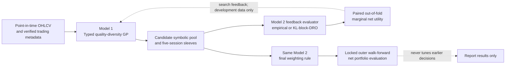

# R-MaRS: Robust Marginal-Value Search for Symbolic Factors

_Research architecture and proposed empirical protocol. This document specifies a study design; it reports no experiment, validated result, or proven novelty claim._

---

## 🎯 Research question and contribution

**Research question.** At matched candidate-query, optimizer-solve, and validation-label budgets—and with wall-clock cost reported—does guiding typed genetic programming (GP) with a block-distributionally robust (block-DRO) estimate of a candidate factor's *out-of-fold marginal portfolio value* produce a better portfolio than guiding the same GP with ordinary empirical-mean marginal portfolio value?

**Single primary hypothesis (H1).** With the final portfolio optimizer fixed to block-DRO in both arms, the robust-feedback search has higher predeclared outer-test net certainty-equivalent return than the ordinary-feedback search. The confirmatory comparison matches candidate queries, optimizer solves, folds, and validation-label access; it also reports a compute-matched sensitivity because the robust solve may require more runtime.

The intended contribution is the **search feedback signal and its controlled test**, not GP, a robust optimizer, multi-objective search, or a two-stage architecture in isolation. This is a proposed distinction, not a priority claim. Related work already covers collection-aware RL search ([AlphaGen](https://doi.org/10.1145/3580305.3599831)), factor generation plus dynamic combination ([AlphaForge](https://doi.org/10.1609/aaai.v39i12.33365)), distributional RL for alpha discovery ([AlphaQCM](https://proceedings.mlr.press/v267/zhu25ag.html)), GFlowNet-based diverse search ([AlphaSAGE](https://arxiv.org/abs/2509.25055)), multi-objective alpha RL ([AlphaPareto](https://arxiv.org/abs/2609.34188)), and rolling multi-objective GP followed by a learner/allocator ([Wang & Geng, 2026](https://doi.org/10.1007/s10614-025-11289-1)). R-MaRS should not claim novelty from those ingredients. Its proposed incremental distinction is: **empirically compare ordinary versus KL-block-DRO marginal portfolio feedback into symbolic search while keeping final deployment weighting identical in the primary test**. Search and verify competing preprints, SSRN papers, and subsequent versions before making any stronger novelty statement.

## 🧭 Two-model architecture

There are exactly two principal models. The CVaR alternative and empirical-feedback arm below are objective/configuration comparisons of Model 2, not additional models. The GP's feedback folds are development data—not an untouched estimate of the GP's selected fitness. Outer walk-forward periods evaluate the complete procedure.

## 🧠 Model 1: typed quality-diversity GP

**Purpose and inputs.** Search readable expression trees formed from only point-in-time OHLCV features. The initial grammar may include lagged returns, bounded rolling statistics, cross-sectional ranks, and protected arithmetic. Each operator has an explicit input/output type, lookback, and missing-value rule. No operator may access future observations. VWAP, fundamentals, sector labels, and macro variables are excluded unless acquired, release-timestamped, and verified before the protocol is frozen.

**Factor sleeve.** At each scheduled signal cutoff, expression `f` scores each eligible security. Convert scores to a long-only top-decile sleeve `h[f,b]`: equal weight among eligible tradable names in the top decile, zero otherwise; ties and minimum-history rules must be fixed before the outer evaluation. This is one proposed construction, not a reported property of the data.

**Quality-diversity search.** Each GP search step has a current pool `S_g`. All offspring in that step are scored against the same `S_g` and the same development folds. Use a generation-local MAP-Elites-style archive: its fixed training-only descriptor is `(factor RankIC quantile, turnover quantile)`; each cell retains the candidate with the largest lower-confidence-bound (LCB) marginal value, breaking ties by fewer AST nodes. Bin edges are fitted on that outer fold's development data and then held fixed for that fold. When a factor is added, start a new archive generation and recompute candidate values against the updated pool—do not compare stale `Δ(f | S_g)` scores computed against different pools. Cap tree depth, lookbacks, generation count, candidate evaluations, and pool size before evaluation. These search details and parameter values require preregistration.

**Candidate selection.** Select the best candidate from a nonempty descriptor cell at each budgeted growth step, even when its LCB is nonpositive; otherwise, individually weak but complementary factors would be excluded before their joint value could be evaluated. Stop at the predeclared pool-size or candidate-evaluation cap, not by an uncorrected inner-score threshold. The optimizer can assign zero weight to a candidate. Such a candidate receives its paired validation difference (often near zero), but is not treated as evidence of useful contribution. The LCB is a search score, not a post-selection confidence interval: repeated GP queries adapt to their feedback data, and this adaptivity is evaluated only on outer periods.

## ⚖️ Model 2: block-DRO ensemble optimizer

### Portfolio and block return definition

Use **non-overlapping five-trading-session episodes** as the proposed primary holding horizon. At the close before episode `b`, compute the signals and eligible universe using information then available. Enter at the next session's executable open, hold through the close of the fifth session, liquidate, and use the next episode's signal for the next entry. Thus each episode starts from cash and ends in cash; every condition, comparator, and fold uses the same schedule.

For `K` candidate sleeves plus cash, let `w=(w_0,w_1,...,w_K)` lie on the simplex `Δ_(K+1)`, where `w_0` is cash and `w_j` is the capital share assigned to sleeve `j`. Let `h_{jib}` be sleeve `j`'s target fraction of its allocated capital in stock `i` for episode `b`; `Σ_i h_{jib}=1` when sleeve `j` is invested. Let `N` denote portfolio NAV and `ADV^{20}_{ib}` the trailing 20-session dollar ADV observable before the episode signal. The total stock notional as a fraction of portfolio NAV is

\[
p_{ib}(w)=\sum_{j=1}^{K} w_j h_{jib},\qquad \sum_i p_{ib}(w)=1-w_0.
\]

Let `R_ib = P_adj,exit / P_adj,entry − 1` be the adjusted-price return from entry open to fifth-session close. The **gross** block return is `Σ_i p_ib(w) R_ib`. The **net** block return `r_b(w)` subtracts stock-level entry and exit costs:

\[
r_b(w)=\sum_i p_{ib}(w)R_{ib}
 -\sum_i C^{buy}_{ib}(p_{ib}(w);N,ADV^{20}_{ib})
 -\sum_i C^{sell}_{ib}(p_{ib}(w)(1+R_{ib});N,ADV^{20}_{ib}).
\]

`n` is a trade notional as a fraction of initial NAV. A candidate convex stock-level cost specification is `C^{buy}_{ib}(n;N,ADV)=c^{buy}_{ib}n+κ^{buy}_{ib}n√(nN/ADV^{20}_{ib})`, with the analogous `C^{sell}`; `c≥0` is the all-in proportional fee/tax/spread rate and `κ≥0` is an impact coefficient. This function is nonnegative, nondecreasing, and convex for `n≥0`. It is a proposed parameterization, not a calibrated market-cost estimate. Estimate `c` and `κ` from verified execution data or report a preregistered sensitivity grid; never invent values. The entry notional is `p_ib(w)` and the exit notional is `p_ib(w)(1+R_ib)`, reflecting the same shares after their realized price change. The cash allocation must cover entry costs: `Σ_i C^buy_ib(p_ib(w);N,ADV^{20}_{ib}) ≤ w_0`. At a training episode's signal time, impose the linear participation constraint `p_ib(w) N ≤ χ ADV^{20}_{ib}` for each eligible name. For specified cost schedule `C`, NAV `N`, and participation cap `χ`, define the feasible set explicitly as

\[
\mathcal W(S;A,N,\chi,C)=\left\{w\in\mathbb R_+^{K+1}:\mathbf 1^\top w=1,\;\sum_i C^{buy}_{ib}(p_{ib}(w);N,ADV^{20}_{ib})\leq w_0,\;p_{ib}(w)N\leq\chi ADV^{20}_{ib}\;\forall i, b\in B_A\right\}.
\]

For compactness, later equations write `𝒲(S;A)` with `N`, `χ`, and cost schedule `C` held fixed.

`χ`, NAV, ADV units, and missing/zero-volume rules are protocol inputs. The cash sleeve has zero return in the primary specification. Exit-capacity violations are reported as realized execution failures, not retroactively filtered away.

This episode-reset design makes stock-level turnover and costs explicit and consistent across arms. It is deliberately a short-horizon research sleeve, not a claim that five-day full liquidation is optimal or representative of all investment mandates.

### Empirical and robust optimization

For an earlier training sample `A`, let `B_A` denote its complete five-session episodes, `p_b=1/|B_A|` (equal block mass), and `x_b=(x_{1b},...,x_{Kb})` be the gross return vector of the `K` factor sleeves. Let `\tilde w=(w_1,...,w_K)` be the risky-sleeve weights; cash `w_0` has zero return and is excluded from risk exposure. Estimate the positive-semidefinite `K×K` covariance `Σ_A` from those training-only vectors using a preregistered shrinkage rule. Define risk aversion `γ≥0` (with inverse-return units), fixed before outer testing. The mean-variance regularizer `γ/2 · \tilde wᵀΣ_A\tilde w` is a fixed training-covariance penalty; it is not reweighted by the block ambiguity set and is not a guarantee of robust variance.

The empirical-feedback optimizer is

\[
w^{O}(S;A)=\arg\max_{w\in\mathcal W(S;A)}
\left[\sum_{b\in B_A}p_b r_b(w)-\frac{\gamma}{2}\tilde w^\top\Sigma_A\tilde w\right].
\]

The primary robust optimizer replaces the empirical block weights by a KL ambiguity set:

\[
\mathcal Q_{KL}(\rho;A)=\left\{q\in\Delta_{|B_A|}:\sum_b q_b\log\frac{q_b}{p_b}\leq\rho\right\},\qquad \rho\geq0,
\]

\[
w^{R}(S;A)=\arg\max_{w\in\mathcal W(S;A)}
\left[\min_{q\in\mathcal Q_{KL}(\rho;A)}\sum_{b\in B_A}q_b r_b(w)-\frac{\gamma}{2}\tilde w^\top\Sigma_A\tilde w\right].
\]

Use `0 log 0 = 0`; with positive empirical masses and `ρ≥0`, the ambiguity set is nonempty because it contains `p`. At `ρ=0`, it reduces to empirical weighting. `𝒲(S;A)` is the set defined above; its capacity constraints use only data available at each episode's signal cutoff. Candidate and cash weights are long-only. If the cost functions are convex, block returns are concave in `w`; with `Σ_A` PSD, the displayed optimizations are concave maximizations over convex feasible sets. State solver/tolerance and test numerical agreement against a small enumerated case. If actual cost or capacity rules violate these assumptions, document the resulting nonconvex problem and do not claim convexity.

The KL-DRO term protects the **expected net block return against reweighting observed historical episodes**. It does not create unseen regimes, guarantee downside protection, or robustify the covariance penalty. The radius `ρ` is chosen using inner development data only and is reported with a sensitivity curve; it is not a universal guarantee. Report the adversarial `q*` as a description of which observed blocks drive the robust solution.

### CVaR downside-risk comparator and regularization terminology

A competing downside-risk objective uses empirical mean net return minus CVaR of block losses:

\[
\max_{w\in\mathcal W(S;A)}\left[\sum_b p_b r_b(w)-\lambda_C\,CVaR_\alpha(-r_b(w))\right],\qquad
CVaR_\alpha(-r)=\min_z\left(z+\frac{1}{(1-\alpha)|B_A|}\sum_b(-r_b-z)_+\right),\quad 0<\alpha<1.
\]

`α` is the tail confidence level and `λ_C≥0` is selected inside training. CVaR is a comparison formulation, not a third model. Compare it with KL-block-DRO at equal data, candidate, and compute budgets; report average and tail results separately.

The optimizer is **not called sparse**: simplex weights do not enforce sparse factor selection, and the primary formulation has no sparsity penalty. A separate, optional **weight-stability** ablation adds

\[
-\eta\lVert w-w^{prev}(S)\rVert_1,\qquad \eta\geq0,
\]

to either Model 2 objective. `w^{prev}(S)` is the previous deployed simplex allocation projected onto the current pool by retaining shared-factor weights, assigning zero to newly added factors, and transferring the removed-factor mass to cash. `η` is a utility penalty per unit L1 allocation change; it is not a transaction-cost model. Set `η=0` in the primary test unless its value and training-only selection rule are approved. Stock-level costs remain in `r_b(w)`.

## 🔄 Exact feedback estimand and adaptive-data contract

For each outer retraining origin `T_o`, the inner development data are split chronologically into an expanding-search history `D_o` and a terminal inner-selection segment `I_o`. Every OOF fold `k` has a strictly earlier expanding training segment `A_k` and a strictly later, non-overlapping validation segment `V_k` of complete five-session episodes. For feedback mode `e∈{O,R}` and current pool `S`, independently refit Model 2 on `A_k` for each of `S` and `S∪{f}`:

\\[
w_{e,k}(S)=w^e(S;A_k),\\qquad
w_{e,k}(S\\cup\\{f\\})=w^e(S\\cup\\{f\\};A_k).
\\]

Neither fit can read `V_k` labels. Freeze each fitted weight vector throughout `V_k`, and evaluate both pools on the **same validation episodes** with the same net certainty-equivalent utility:

\\[
U_{V_k}(w;S)=\\bar r_{V_k}(w;S)-\\frac{\\gamma}{2}s^2_{V_k}(w;S),
\\]

where `r_b(w;S)` includes identical stock-level costs, `\\bar r` is the arithmetic mean per five-session episode, and `s²` is the sample variance across those episodes. The paired fold difference and chronological OOF fitness are

\\[
d_{e,k}(f\\mid S)=U_{V_k}(w_{e,k}(S\\cup\\{f\\});S\\cup\\{f\\})-U_{V_k}(w_{e,k}(S);S),\\qquad
\\widehat{\\Delta}_e(f\\mid S)=\\frac{\\sum_k n_k d_{e,k}(f\\mid S)}{\\sum_k n_k},
\\]

with `n_k=|V_k|`, the number of complete five-session episodes in fold `k`. Every GP candidate is scored on the same fixed set of chronological OOF windows; it is the paired OOF marginal utility—not an in-sample optimizer objective—that supplies Model 1's fitness.

The LCB used to rank candidates is the one-sided 95% lower endpoint from a paired moving-block bootstrap of episode-level validation differences, using the **same resampled time blocks** for `S` and `S∪{f}`. Fix the bootstrap block-length rule from development data. This LCB is a search score, not a post-selection confidence interval. GP reuses OOF feedback across queries by design; log every candidate, pool context, fold, optimizer solve, and label access, and apply identical query limits to both feedback arms. New pool states start a new generation and all candidates are re-scored against that common pool so stale, context-incomparable scores are not carried forward.

**Adaptive-overfitting control.** The chronological OOF windows in `D_o` are explicitly *search-feedback data*, not independent model-selection data. GP never queries the later `I_o` segment. After the search budget is exhausted, score only a predeclared finite set of GP checkpoints/hyperparameter configurations once on `I_o`; select the checkpoint/configuration by the preregistered criterion, log all tried configurations, and do not iterate further on `I_o`. The outer test remains untouched and is the only assessment of the selected end-to-end procedure. The final DRO fit may use all eligible data through `T_o` only after the pool and hyperparameters are frozen.

## ⚖️ Controlled feedback comparison

**Ordinary marginal feedback** uses `q=p` in the inner candidate optimizers and computes `\widehat\Delta_O`. **Robust marginal feedback** uses `q∈𝒬_KL(ρ)` and computes `\widehat\Delta_R`. Both use the same candidate grammar, training/validation episodes, stock-level costs, risk aversion, capacity rules, **certainty-equivalent (CE) validation score**, bootstrap, GP archive, stopping rule, and candidate query schedule.

**Primary contrast:** generate one factor pool with each feedback mode, but fit the **same final KL-block-DRO optimizer** on all allowed pre-outer training data for both pools. Compare their paired outer-test net certainty-equivalent returns. This isolates the effect of feedback mode while holding final weighting fixed.

A 2×2 factorial is feasible because Model 2's inner feedback objective and final deployment objective are independently configurable without adding a model:

| GP feedback objective | Final empirical optimizer | Final KL-block-DRO optimizer |
|---|---|---|
| Ordinary empirical marginal value | Cell OO | Cell OR (**primary ordinary-feedback arm**) |
| Robust KL-DRO marginal value | Cell RO | Cell RR (**primary robust-feedback arm**) |

Report the feedback main effect `(RO+RR−OO−OR)/2` and interaction `(RR−OR)−(RO−OO)`; the primary test remains `RR−OR`. The CVaR objective is a separate Model 2 comparator, not silently substituted into these four cells.

**Resource matching.** Match unique expression evaluations, candidate-to-pool queries, optimizer solve counts, folds, and validation-label reads exactly across ordinary and robust feedback arms. Report solver iterations, wall-clock, peak memory, and any numerical failures. Since a KL-DRO solve may cost more than an empirical solve, also report a compute-matched sensitivity at a common wall-clock/compute cap and disclose any resulting difference in expressions or queries; do not call expression-count matching alone “compute matched.”

## 🧪 Nested expanding-window walk-forward experiment

### Chronology, folds, and retraining

Let `t_0` be the earliest date that passes all point-in-time data gates. Do not assign calendar cutoffs until those gates establish actual usable coverage. The following are **protocol defaults**, not claims about observed sample dates:

1. **Initial history and outer origins.** Require a three-calendar-year expanding warm-up before the first OOF validation window, then at least one complete three-month OOF window and the terminal three-month inner-selection segment before the first outer origin; hence the first `T_0` is no earlier than `t_0 + 42 calendar months`, subject to verified coverage. Set `T_0` to the last verified trading session at the first calendar-quarter end meeting that condition; set each later outer origin six calendar months later on the same quarter-end grid. At each origin, the expanding outer training set is all eligible observations through `T_o`; the untouched forward test block is `(T_o, T_o + 6 calendar months]`, restricted to complete five-session episodes and verified coverage. If the point-in-time universe or execution record does not cover an entire block, shorten/omit it under a preregistered rule rather than inventing dates.
2. **Full retraining at each origin.** At every `T_o`, rerun the complete typed GP search from its frozen initialization/seed schedule using only `D_o` OOF feedback, select its final pool using `I_o`, then refit the final KL-block-DRO weights using all eligible historical episodes through `T_o`. Freeze the factor pool, GP grammar/settings, selected hyperparameters, cost assumptions, and final weights for that outer test block. No GP search, hyperparameter tuning, or final-weight refit uses an outer-block outcome.
3. **Inner expanding OOF folds.** Define `I_o` as the final three calendar months of the outer training history; `D_o` is the earlier training history. Starting at `t_0` plus the three-year warm-up, partition `D_o` into consecutive, non-overlapping three-calendar-month validation windows `V_1,...,V_{J_o}`, aligned to calendar-quarter boundaries and retaining only complete five-session episodes. Any partial interval between the last complete `V_k` and `I_o` is excluded from OOF scoring but remains eligible for the final refit. For each `V_k`, let `A_k` contain all eligible historical episodes from `t_0` up to the start of `V_k`, expanding with `k`. Fit the ordinary or robust optimizer separately on `A_k` for `S` and `S∪{f}`; evaluate each frozen fit on the same `V_k`. GP fitness is the episode-count-weighted OOF estimate defined above. `I_o` is not part of these OOF fitness folds.
4. **Selection and final refit.** After GP stops, use `I_o` once to compare the predeclared finite checkpoint/hyperparameter set. Freeze the selected pool and settings, then refit Model 2 on all eligible data through `T_o`, including `I_o`. This refit is permitted because `I_o` is historical at the outer origin; its outcomes never determine outer predictions before `T_o`.
5. **Retraining frequency.** The complete GP-plus-DRO pipeline is retrained every six calendar months at the outer origins. It is not retrained inside an outer test block. Within the block, formula scores and stock sleeves are recomputed at each five-session signal cutoff; final factor-ensemble weights stay fixed.

### Information boundaries and purge/embargo

Features and universe membership at a signal cutoff use only information released by that cutoff. A label is the net return from next-session open through the fifth-session close and becomes available only after that close and the cost/execution record are observed. At every `A_k/V_k`, `D_o/I_o`, and outer train/test boundary, exclude any episode whose label interval overlaps the later segment; apply a five-trading-session minimum purge/embargo where needed and retain a full feature-lookback gap if it is longer. Validation/selection labels never enter the corresponding optimizer fit. OOF development returns may be revisited only as logged search feedback; `I_o` is not exposed to GP; outer-test labels cannot tune any decision. In sequential expanding evaluation, a completed earlier outer block may become ordinary past-only history at a later origin, but no prior reported prediction is revised.

### Outer aggregation and sensitivity analysis

Aggregate the locked outer-test predictions and net five-session returns across all eligible non-overlapping outer blocks, preserving their chronological alignment. The primary endpoint and `RR−OR` test are defined above; no result from any outer block may select the final pool, radius, cost model, stopping point, or reported metric. Apply the paired dependence-aware bootstrap to the combined outer sequence and report seed variation separately from time-series uncertainty.

As **secondary fixed-length training-window sensitivities**, repeat the same outer test blocks with trailing three-year and five-year outer training windows, using only origins with the complete window and all data gates satisfied. Within each fixed window, let each inner `A_k` expand from that window's start, use a 24-month inner warm-up, then consecutive non-overlapping three-month OOF folds, followed by the same terminal three-month inner-selection segment; refit Model 2 on the full fixed window after pool/settings selection. Keep outer blocks, feature timing, search/query budgets, embargo, and final-test rules unchanged. The shorter warm-up applies only to these secondary fixed-window analyses and must be reported; do not fill missing history or extrapolate dates.

## 🛡️ Point-in-time data gates

The observed directory contains `data/VN100/ohlcv.csv`, `constituents.csv`, `constituent_tracking.csv`, `index.csv`, `breadth.csv`, `macro.csv`, `derivatives.csv`, `fx.csv`, and `bond.csv`. Their presence does **not** establish a valid tradable panel. No executable VN100 backtest or complete sample window is claimed until all gates below pass.

| Gate | Evidence required before analysis | Fail-closed consequence |
|---|---|---|
| Universe and membership | Announcement and effective dates for constituent additions/removals; historically eligible names, delisted names, and point-in-time ranking rules | Do not label the study VN100 or use a future constituent list to build an earlier universe |
| Corporate actions and terminal events | Split/dividend-adjusted open/close prices; delisting proceeds/returns; suspensions and limit-lock records | Do not compute headline return/CE results for affected intervals; missing terminal events cannot be silently dropped |
| Execution | Evidence that the chosen next-open entry and fifth-session-close exit are executable; auction/price-limit handling; no fills on unavailable prices | Record blocked/partial orders; do not impute ideal fills |
| Liquidity and costs | Volume units/currency; lagged ADV; predeclared NAV and participation limit; all-in fees/taxes/spread and calibrated impact or transparent sensitivity schedule | No “net tradable” claim; disclose unmatched or uncalibrated costs |
| Feature availability | Timestamp/release-lag audit for every non-price input; missingness and warm-up/sentinel audit | Exclude features without point-in-time availability; never forward-fill across an unknown release boundary |
| Panel integrity | Duplicate keys, consistent calendars, valid OHLC relationships, ticker mapping, and reproducible exclusion log | Freeze and report exclusions; no silent row deletion |

If these gates cannot be met, the viable alternative is a clearly labeled synthetic or semi-synthetic methods study, not an executable VN100 portfolio claim. Do not silently substitute present-day constituents, unadjusted prices, empty columns, or assumed transaction-cost values.

## 📚 Related-work comparison and claim boundary

| Work | Established in the cited work | R-MaRS comparison question; no priority claim implied |
|---|---|---|
| AlphaGen (Yu et al., 2023) | RL uses downstream collection performance to generate synergistic formulaic factors | Does robust block-DRO marginal utility improve the feedback signal under matched access/budget? |
| AlphaForge (Shi et al., 2025) | Factor generation with dynamic temporal factor combination | Does feedback change the discovered pool beyond dynamic combination applied after search? |
| AlphaQCM (Zhu & Zhu, 2025) | Distributional RL models uncertainty to guide alpha-discovery exploration | Does a portfolio-level block-reweighting objective improve the selected tradable pool, distinct from exploration variance? |
| AlphaSAGE (Chen et al., 2025/2026 preprint) | Structure-aware GFlowNet search promotes diverse alpha discovery | Diversity-preserving search is not claimed as R-MaRS's novelty |
| AlphaPareto (Zhao et al., 2026 preprint; page reports NeurIPS 2026 acceptance) | Multi-objective RL includes predictive, stability, perturbation-robustness, and diversity objectives | Generic multi-objective or robust alpha discovery is not claimed; distinguish perturbation robustness from portfolio block reweighting |
| Wang & Geng (2026) | Rolling multi-objective GP followed by LightGBM/portfolio allocation | GP plus a downstream optimizer is not the claimed contribution; compare specifically on feedback definition and matched controls |

These descriptions are based on the linked publications/preprint records, not a systematic review. Recheck papers, SSRN, and code immediately before a priority claim; absent an exhaustive review, phrase the contribution as a hypothesis to test, not “first” or “novel.” The KL ambiguity formulation is a discrete empirical-distribution stress model, not a claim of a new DRO set. Delage & Ye (2010), *Distributionally Robust Optimization Under Moment Uncertainty with Application to Data-Driven Problems*, provides foundational data-driven DRO context ([DOI](https://doi.org/10.1287/opre.1090.0741)). White (2000), *A Reality Check for Data Snooping*, [DOI](https://doi.org/10.1111/1468-0262.00152), motivates search-aware inference but does not by itself specify the full adaptive-search correction for this design.

## ⚠️ Decisions awaiting author approval

The architecture fixes the protocol skeleton but does not fabricate data, costs, or results. Before implementation, preregister and approve:

1. `γ` for the primary certainty-equivalent endpoint; the primary economic effect threshold and test level.
2. KL radius `ρ` selection rule and its inner-only sensitivity grid; CVaR `α` and `λ_C` comparison tuning rule.
3. Portfolio NAV, currency/units, ADV window validity, participation cap `χ`, cost calibration data or the proportional-plus-impact parameters `c` and `κ`, and approved cost-stress scenarios.
4. GP grammar/types, pool cap, descriptor definitions/binning, search iterations, query budget, seeds, complexity tie-break, and stop rule.
5. Exact inner rolling-origin and selection-window lengths; bootstrap block-length rule; outer six-month calendar cutoffs after data gates pass.
6. Point-in-time constituent, corporate-action, delisting, suspension, price-limit, benchmark, and fill sources; exclusions and missing-data policy.
7. Whether optional weight-stability regularization is included (`η=0` in the primary specification unless approved) and its training-only selection rule.

## ✅ Final methodological audit

**Remaining mathematical issue:** the KL ambiguity set and net block return objective are well-defined, and the cash-reserve/capacity constraints make the episode construction explicit. Convexity depends on the chosen transaction-cost curves actually being convex and on the block return being concave in `w`; verify both and solver feasibility before implementation. The covariance penalty is fixed from training data and is **not** made robust by the KL set.

**Remaining leakage risk:** candidate fitness reuses development feedback data by design. It is not an unbiased confidence interval. Keep the later inner-selection segment and outer test inaccessible to GP queries, purge overlapping labels, and make the complete procedure's performance claim only from outer walk-forward results.

**Remaining fairness risk:** KL-DRO and empirical solves may differ in runtime. Match data access, expression evaluations, solve counts, and folds; report wall-clock and compute-matched sensitivity rather than claiming perfect compute parity where it was not achieved.

**Remaining unsupported claims:** no evidence yet establishes better performance, tradability, novelty, robustness to unseen regimes, or publication readiness. Do not make those claims unless the approved data gates pass and the registered experiment supports them.

## 📚 References

- Yu et al. (2023). *Generating Synergistic Formulaic Alpha Collections via Reinforcement Learning*. KDD. [DOI](https://doi.org/10.1145/3580305.3599831)
- Shi et al. (2025). *AlphaForge: A Framework to Mine and Dynamically Combine Formulaic Alpha Factors*. AAAI. [DOI](https://doi.org/10.1609/aaai.v39i12.33365)
- Zhu & Zhu (2025). *AlphaQCM: Alpha Discovery in Finance with Distributional Reinforcement Learning*. ICML/PMLR. [Proceedings](https://proceedings.mlr.press/v267/zhu25ag.html)
- Chen et al. (2025, revised 2026). *AlphaSAGE: Structure-Aware Alpha Mining via GFlowNets for Robust Exploration*. Preprint. [arXiv](https://arxiv.org/abs/2509.25055)
- Zhao et al. (2026). *AlphaPareto: Formulaic Alpha Discovery with LLM-Guided Multi-Objective Reinforcement Learning*. Preprint. [arXiv](https://arxiv.org/abs/2609.34188)
- Wang & Geng (2026). *Dynamic Factor Mining Based on Multi-Objective Fitness and Its Empirical Study in Multi-Factor Strategies*. *Computational Economics*. [DOI](https://doi.org/10.1007/s10614-025-11289-1)
- Delage & Ye (2010). *Distributionally Robust Optimization under Moment Uncertainty with Application to Data-Driven Problems*. *Operations Research*. [DOI](https://doi.org/10.1287/opre.1090.0741)
- White (2000). *A Reality Check for Data Snooping*. *Econometrica*. [DOI](https://doi.org/10.1111/1468-0262.00152)
- Rockafellar & Uryasev (2000). *Optimization of Conditional Value-at-Risk*. *Journal of Risk*. [DOI](https://doi.org/10.21314/JOR.2000.038)
